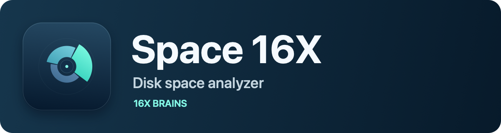
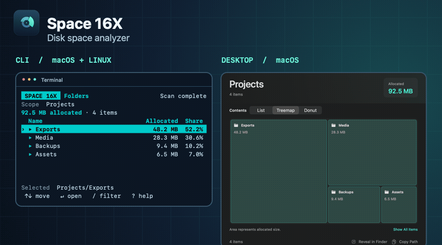

<p align="center">
  
</p>

# Space 16X

Find the file or folder using your disk space. Space 16X is a disk analyzer with a native macOS app and a Rust terminal explorer for macOS and Linux. Both rank by allocated size, scan read-only filesystem metadata, and work offline without an account. The only change Space 16X makes to your files is moving items you choose to the Trash, after you confirm.

Space 16X is a project by Muhammad Naveed Akram, developed under the [16X Brains](https://16xbrains.com/) banner.



## Analyze a folder on macOS

1. Choose a folder or local drive, or drop it into the Space 16X window.
2. Browse the folder list, treemap, or donut chart. Drill down with the breadcrumb or switch to **Largest Files**. Click a column header to sort by name, size, or item count.
3. Press Space to preview a selected item with Quick Look, reveal it in Finder, or copy its path. To free space, select items and press ⌘⌫. After you confirm, they move to the Trash and the results update in place. Space is freed when you empty the Trash. After you change files elsewhere, **Scan → Rescan Folder** (⌥⌘R) updates just the open folder.
4. To keep a scan, choose **File → Export Scan…**. **File → Open Scan…** browses it later, read-only, along with scans saved by the CLI, ncdu, or gdu.

The Mac app uses allocated size for totals, rankings, and chart shares. Choose **View → Size → Apparent Size** to use file lengths instead. The **Items** column counts the files and folders inside each folder. To skip folders such as `node_modules` or caches, list patterns under **Settings → Exclude from scans**. On a large scan, the first two levels are available while deeper folders are scanned. The progress strip shows the current path, and the list marks pending folders. A cancelled scan keeps the preview and labels its unfinished folders.

The treemap shows the largest items with a positive size. Remaining bytes are grouped as **Other Items**. Switch back to **List** to inspect each item.

## Explore from the terminal

Run `space16x` with no arguments to open the interactive explorer for your current folder.

```sh
space16x
space16x "$HOME/Downloads"
space16x scan "/Volumes/Work" --depth 2
space16x scan "$HOME/Downloads" --top 20
space16x scan --top 10 --json > report.json
space16x --exclude node_modules --exclude '*.log' ~/Projects
space16x scan /mnt/archive --threads 1
ssh -C server space16x scan / --export - | space16x --import -
```

Use the arrow keys and Enter to drill into a folder, `/` to filter, `f` for the largest files, `s` to sort by size, item count, or name, `a` for apparent sizes, `r` to rescan the open folder, and `?` for help. Press Space to mark items and `d` to move them to the Trash after you confirm. Space is freed when you empty the Trash. Pass `--read-only` to turn this off. The `scan` command provides plain text and JSON for scripts. Scans read metadata on up to 8 threads. Pass `--threads 1` on hard disks and network filesystems. `scan --export` saves a scan in ncdu's JSON format, and `--import` browses a saved scan read-only, including one from ncdu or gdu, so you can scan a server and browse it locally.

Exit code `0` means the scan completed, `2` means it returned partial results, and `1` means the scan could not start or complete. A partial JSON report carries its issues and totals on standard output. See the [CLI reference](docs/cli.md) and [example report](docs/example-report.json).

## Build and install

The candidate CLI targets are Apple silicon and Intel on macOS 14 or later, plus static Linux builds for x86-64 and ARM64. From a source checkout, install the CLI with Rustup and Cargo.

```sh
(cd cli && cargo install --locked --path . --root "$HOME/.local")
"$HOME/.local/bin/space16x" --help
```

Build and open the native app on macOS with Swift 6 or later.

```sh
open "$(scripts/package-macos.sh)"
```

Releases from 0.2.2 include the universal Mac app. Install it with Homebrew. Homebrew 6 and later require you to trust the tap first.

```sh
brew tap engrmnaveed/tap && brew trust engrmnaveed/tap && brew install --cask engrmnaveed/tap/space16x
```

The app is free and open source, and it is not notarized by Apple, so macOS blocks the first launch. In the warning, click **Done**, not **Move to Trash**. Then open **System Settings → Privacy & Security**, scroll to **Security**, and click **Open Anyway**. See [Allow the first launch](docs/install.md#allow-the-first-launch) for every step. The [installation guide](docs/install.md#install-the-mac-app) also covers the direct download, verification, and removal.

Install a checksummed CLI build from GitHub without sudo. Paste either line in Bash or Zsh.

```sh
space16x_path=$(curl --proto '=https' --tlsv1.2 -fsSL https://raw.githubusercontent.com/engrmnaveed/diskspace-16x/f36f06107316d5a0312f9c52c4a4e96f2cb34597/scripts/install.sh | sh -s -- --shell-path) && [ -n "$space16x_path" ] && export PATH="$space16x_path" && unset space16x_path
```

```sh
space16x_path=$(wget -qO- https://raw.githubusercontent.com/engrmnaveed/diskspace-16x/f36f06107316d5a0312f9c52c4a4e96f2cb34597/scripts/install.sh | sh -s -- --shell-path) && [ -n "$space16x_path" ] && export PATH="$space16x_path" && unset space16x_path
```

To uninstall and clean up this shell's PATH, run the same installer with `--uninstall`.

```sh
space16x_path=$(curl --proto '=https' --tlsv1.2 -fsSL https://raw.githubusercontent.com/engrmnaveed/diskspace-16x/f36f06107316d5a0312f9c52c4a4e96f2cb34597/scripts/install.sh | sh -s -- --uninstall --shell-path) && [ -n "$space16x_path" ] && export PATH="$space16x_path" && unset space16x_path
```

See the [installation guide](docs/install.md) for Wget removal, Fish commands, version pinning, and platform support.

## How totals are counted

- Allocated bytes come from filesystem metadata. A sparse file can have a large reported length and use very few disk blocks. Apparent sizes add up those reported lengths instead, under the same hard-link and cloud rules.
- Item counts include every file and folder inside a folder, counting each hard-linked file once. Excluded paths are skipped without being read and aren't counted.
- Sizes use decimal units, as Finder and System Settings do: 1 GB is 1,000,000,000 bytes. The Mac app's size tooltips and the CLI explorer's file details also show the exact byte count and the binary size in GiB, where 1 GiB is 1,073,741,824 bytes.
- Directory totals sum regular-file bytes within the scan. A hard-linked file contributes once. Symbolic links and mounts on other devices are skipped.
- On the macOS startup disk, both scanners count APFS firmlinked folders such as `/Users` at their visible paths and skip their duplicate paths under `/System/Volumes/Data`. A direct scan of the Data volume includes those folders.
- macOS scans keep cloud-only placeholders as references with zero counted bytes and leave cloud-only folders unexpanded. If a metadata call stalls in a known iCloud or File Provider directory, the scan skips the affected path and reports partial results.
- If a descendant cannot be inspected, the scan continues and marks its result as partial. Open the scan details to see which paths were affected.
- Folders the system won't let any app read, such as other apps' data or root-only system folders, are listed as protected rather than as errors. Their contents aren't counted. On macOS, [Full Disk Access](docs/install.md#full-disk-access) lets both apps read folders protected by privacy settings. Folders protected by System Integrity Protection stay unreadable.
- APFS clones can share blocks and snapshots can retain blocks. Scan totals can differ from volume usage and the amount of space reclaimed after deleting a file.
- Scan results reflect metadata observed during the traversal. Activity in the scanned folders can change results between runs.

## Contribute

Start with the [contributor guide](CONTRIBUTING.md) for the package layout, tests, and benchmark. See the [changelog](CHANGELOG.md) for release scope.

## License

Space 16X is licensed under the [MIT License](LICENSE).
