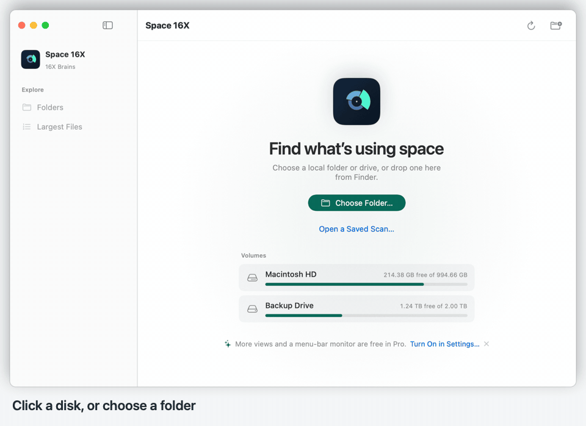
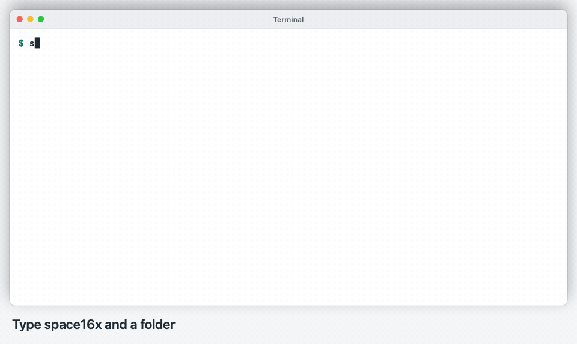

# DiskUse16x user guide

DiskUse16x shows you what's filling up your disk, so you can free space with confidence.

- **See it at a glance.** Your folders ranked from biggest to smallest, as a list or as a picture.
- **Find the big files fast.** The largest files anywhere on a disk, in one list.
- **Clean up safely.** Move what you don't need to the Trash. Nothing is gone until you empty it.

It's free and open source, works offline, and needs no account.

## Pick your path

<table>
<tr>
<th width="50%">On a Mac, with windows and charts</th>
<th width="50%">In a terminal, on a Mac or Linux</th>
</tr>
<tr>
<td></td>
<td></td>
</tr>
<tr>
<td><b><a href="mac-quick-start.md">Mac app quick start →</a></b> Click a disk or folder, then browse a list, a treemap and a donut chart.</td>
<td><b><a href="terminal-quick-start.md">Terminal quick start →</a></b> Type <code>diskuse16x</code> and explore with the arrow keys. Great for servers.</td>
</tr>
</table>

Not sure? On a Mac, start with the app. Both show the same numbers, so you can use either one, or both.

## Watch a walkthrough

Two short videos with on-screen captions show every step:

- **Mac app walkthrough** (2:46): [watch on YouTube](https://youtu.be/34wE80c-4d0)
- **Terminal walkthrough** (2:30): [watch on YouTube](https://youtu.be/5aBSDL4HIuo)

## What you can do

1. **[Find what's using space](find-what-uses-space.md):** read the list, the treemap and the donut, and find the largest files.
2. **[Clean up safely](clean-up.md):** move items to the Trash, and rescan after changes.
3. **[Save, share and check servers](save-and-share.md):** keep a scan, open it later, and scan a server from your own computer.
4. **[DiskUse16x Pro](pro.md):** free extra views, such as cleanup suggestions, a duplicate finder and scan comparisons.
5. **[FAQ and troubleshooting](faq.md):** permissions, why sizes differ from Finder, and what DiskUse16x never does.

## Our promise

DiskUse16x only looks. While it scans, it reads the names and sizes of your files, never what's inside them. The one change it ever makes is moving the items you pick to the Trash, after you confirm.

---

The screenshots, GIFs and videos come from the real app and CLI. [User guide media](../promo.md#user-guide-media) explains how to rebuild them.
