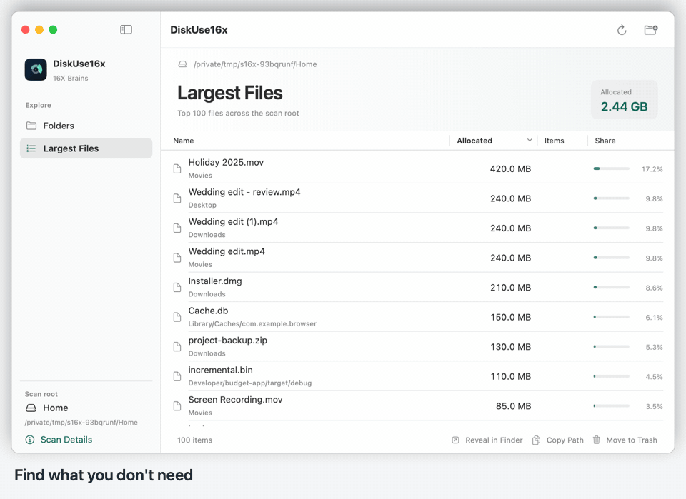
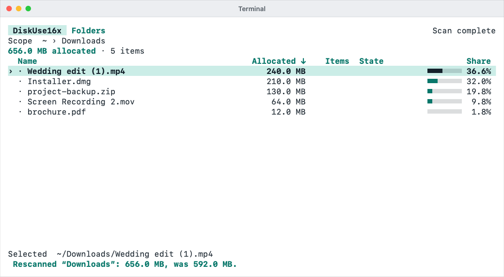

# Clean up safely

DiskUse16x frees space one way only: it moves the items you choose to the Trash, after you confirm. Nothing is deleted for good until you empty the Trash yourself.

## Move items to the Trash in the Mac app

1. Select what you don't need. Click one item, hold ⌘ and click to add more, or hold ⇧ and click to select a range. This works in the folder list and in **Largest Files**.
2. Press ⌘⌫, click **Move to Trash** at the bottom of the window, or right-click and choose **Move to Trash…**.
3. Check the confirmation. It says how many items you picked and how much space they use. Click **Move to Trash**, or **Cancel** to keep them.

The items leave the list right away, and every total above them updates. You don't need to scan again.

## Move items to the Trash in the terminal

1. Highlight an item and press Space to mark it. A ✓ appears, and the top line counts what's marked. You can mark items in different folders and in the largest-files view.
2. Press `d`. With nothing marked, `d` offers the highlighted item.
3. The bottom line asks you to confirm the count and size. Press `y` to move them, or any other key to keep them.

On a Mac, items go to the same Trash as Finder's. On Linux, they go to the Trash your desktop's file manager uses, so you can restore them from there or with `gio trash --restore`. On a disk without a usable Trash, such as a read-only one, the item stays put and the bottom line says why.

## Get the space back

Emptying the Trash frees the space. Until you do, everything you moved is still in the Trash if you change your mind.

Sometimes emptying the Trash frees less than you expected:

- **Copies that share space.** On a Mac, Finder's Duplicate command makes a "clone" that shares its space with the original until either one changes. Removing just one of them frees almost nothing.
- **Hard links.** Some files appear in two places but are stored once. The space comes back only when every copy is gone.
- **Snapshots.** Time Machine keeps recent local snapshots, which hold on to deleted files for about a day, or until macOS needs the space.

✨ **Pro, free:** **Exclusive size** shows what removing each item frees at least, and **Explain Disk Space** shows snapshots and other space a scan can't see. See [DiskUse16x Pro](pro.md).

## What DiskUse16x won't move

To keep you safe, DiskUse16x doesn't offer to move:

- items it couldn't read completely, such as **Protected**, **Incomplete** or **Cloud only** ones
- anything at all while a scan is still running
- items in a saved scan you opened, because those files may be on another computer or may have changed

In the terminal, `diskuse16x --read-only` turns Move to Trash off completely, which is handy on a shared server.

## What's safe to remove?

DiskUse16x shows you what's big. You decide what to remove. Some rules of thumb:

- **Usually safe:** old downloads, installers you've already used, video exports and copies of files you keep elsewhere.
- **Think twice:** anything in **Library** or system folders. Apps keep settings and data there.
- **If you don't know what it is, leave it.** Look it up first, or keep it.

✨ **Pro, free:** **Cleanup suggestions** list folders that apps and developer tools recreate on their own, such as caches and build output, so you know they're safe to clear. See [DiskUse16x Pro](pro.md#cleanup-suggestions).

## Rescan after changes

When you delete or add files outside DiskUse16x, rescan just the folder you're in. It's much quicker than scanning everything again.

- **Mac app:** choose **Scan → Rescan Folder** (⌥⌘R), or right-click a folder and choose **Rescan Folder**. **Scan → Scan Again** (⌘R) scans the whole location again.
- **Terminal:** press `r`. The bottom line reports the folder's new size and its old one. Press `c` to cancel a rescan and keep the earlier results.

