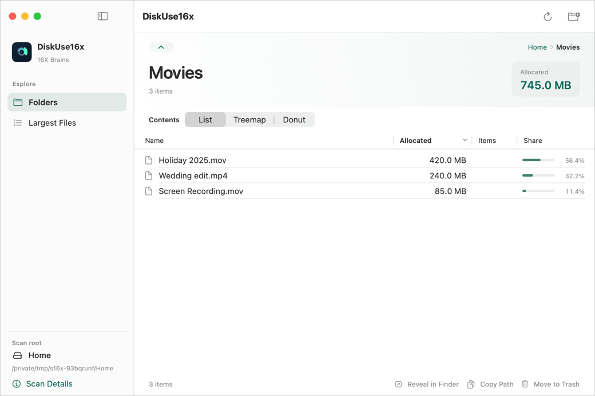
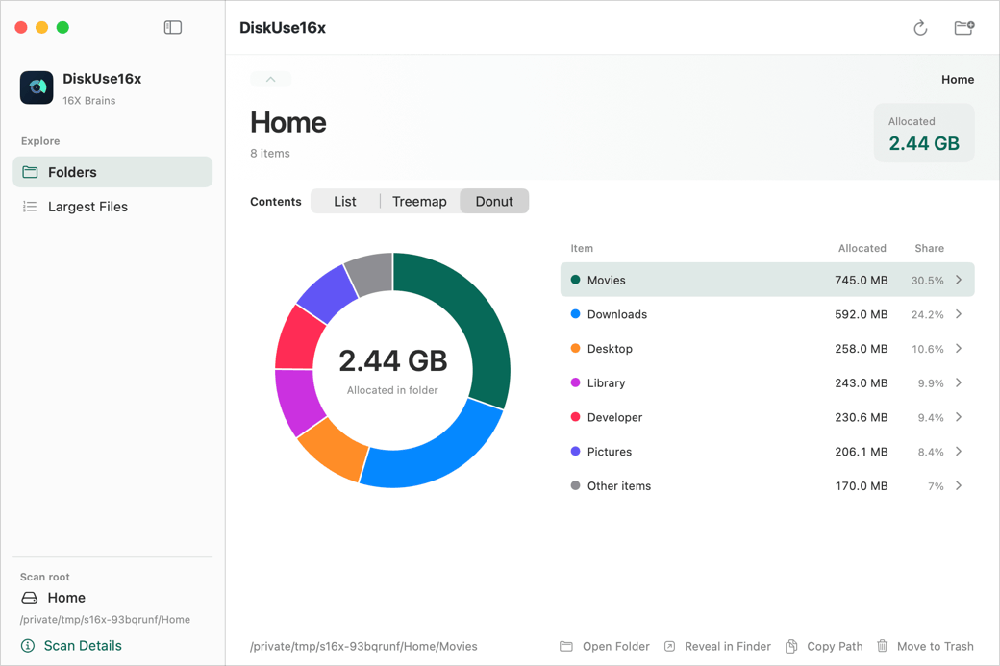
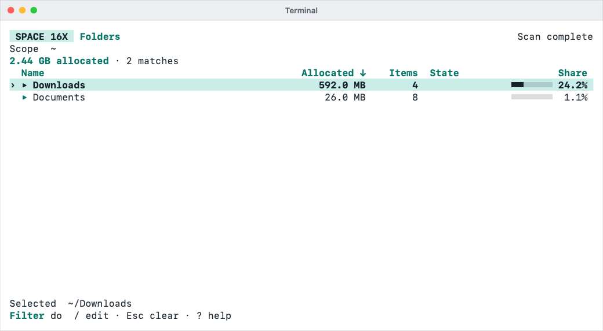
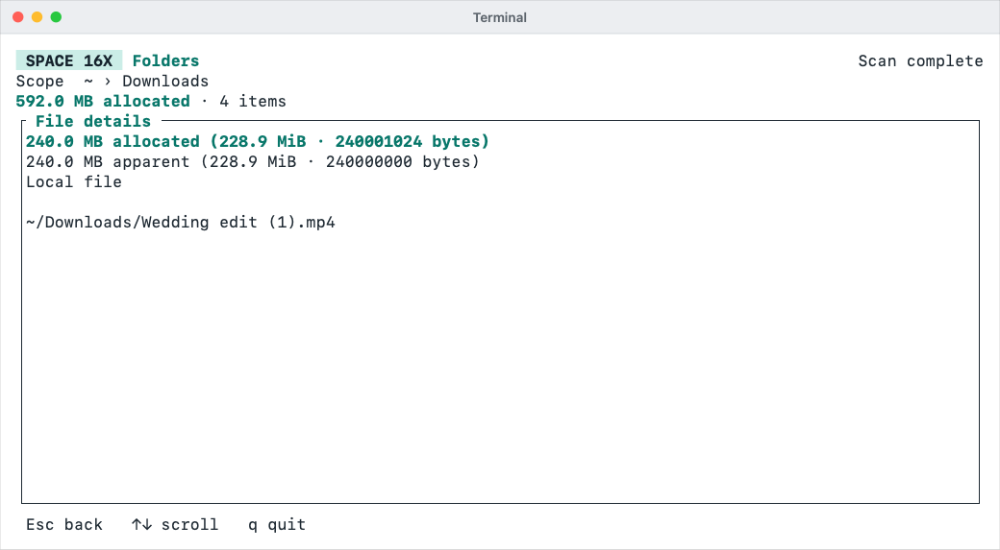
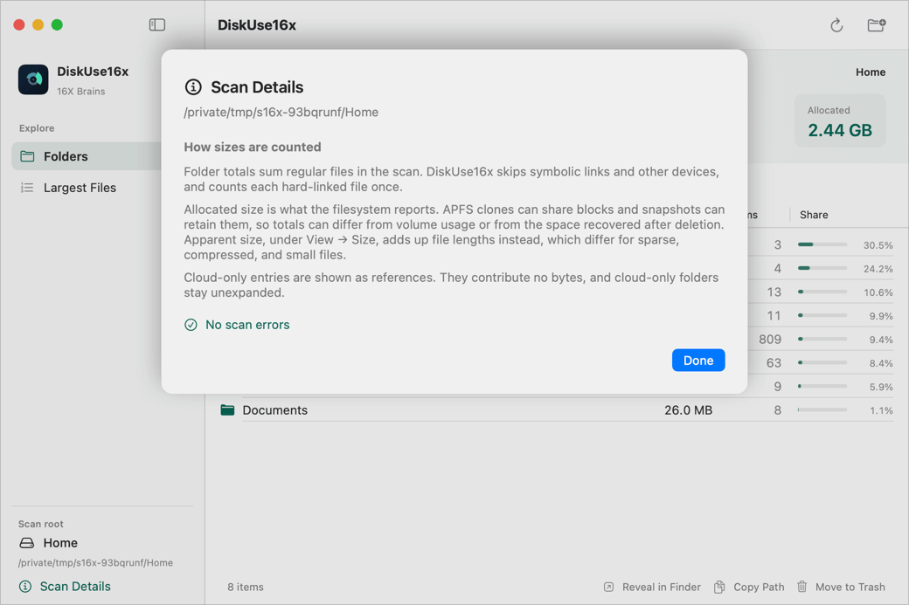

# Find what's using space

DiskUse16x ranks everything by the space it takes, so the answer is always near the top. This page shows how to read the results and dig in, in the Mac app and in the terminal.

## Read the list

Every folder you open shows its contents, biggest first.

| Column | What it means |
| --- | --- |
| **Name** | The file or folder. Folders have a folder icon in the app and a ▸ in the terminal. |
| **Allocated** | The disk space the item uses. For a folder, it's everything inside. |
| **Items** | How many files and folders are inside a folder. |
| **Share** | The item's part of the folder you're looking at. |

Some rows carry a state instead of a full size:

- **Pending** or **Scanning**: DiskUse16x is still counting this folder. You can browse while it works. If you cancel a scan, unfinished folders say **Unscanned** in the app.
- **Protected**: macOS or Linux doesn't let apps read this folder, so its contents aren't counted. See [Some folders say Protected](faq.md#some-folders-say-protected).
- **Cloud only**: an iCloud or other cloud file that isn't downloaded. It counts as zero, and DiskUse16x never downloads it.
- **Incomplete**: something inside couldn't be read. Open the scan details to see what.

## Dig into folders

- **Mac app:** double-click a folder, or select it and press ⌘↓. Go back up with ⌘↑ or by clicking a folder in the path at the top.
- **Terminal:** highlight a folder and press Enter. Go back up with ← or Backspace.

A good habit: open the biggest folder, then the biggest folder inside it, and repeat. A few clicks usually lead to the culprit.

## See it as a picture (Mac app)

Above the list, switch **Contents** between **List**, **Treemap** and **Donut**.

- The **treemap** draws each item as a box sized by the space it uses, so the biggest things jump out. Click a folder's box to open it, or a file's box to select it. Small leftovers are grouped as **Other Items**.
- The **donut** shows each item's share as a slice. Click a folder in the legend beside it to open it.

✨ **Pro, free:** the terminal gets a treemap too. Press `m` in the explorer. See [DiskUse16x Pro](pro.md).

## Find the largest files

Big files hide deep inside folders. This view finds them wherever they are.

- **Mac app:** click **Largest Files** in the sidebar, or press ⌘2. It lists the 100 biggest files in the scan. Double-click one to show it in Finder.
- **Terminal:** press `f`. Enter on a file jumps to the folder that holds it. Press `f` again to go back to the folders.

## Sort and filter

- **Sort, Mac app:** click a column heading, such as **Items**, to sort by it. Click again to reverse the order.
- **Sort, terminal:** press `s` to cycle between size, item count and name.
- **Filter, terminal:** press `/`, type part of a name, and press Enter. Esc clears the filter.

Sorting by **Items** finds folders full of tiny files, which slow down backups and copying.

## Look closer at an item

**Mac app:**

- Press Space to preview the selected file with Quick Look.
- Right-click an item, or use the buttons at the bottom, for **Reveal in Finder** and **Copy Path**.
- Hover over a size to see the exact number of bytes.

**Terminal:** press Enter on a file to see its details: both sizes, the exact byte count, and its full path.

## Go further

### Allocated size and apparent size

DiskUse16x counts **allocated size** by default: the space a file really takes on the disk. A file's **apparent size** is its length, the number Finder shows first in Get Info. The two differ for some files, such as compressed files or disk images that reserve space they don't use yet.

- **Mac app:** choose **View → Size → Apparent Size**. DiskUse16x remembers your choice.
- **Terminal:** press `a`, or add `--apparent` to `diskuse16x scan`.

[Why sizes differ from Finder](faq.md#why-dont-the-sizes-match-finder) explains more.

### Skip folders you don't care about

Leave out folders such as `node_modules` or caches to make scans faster and the results cleaner. Skipped items aren't read or counted.

- **Mac app:** open **DiskUse16x → Settings…** and type one pattern per line under **Exclude from scans**, such as `node_modules` or `*.log`. The next scan uses them.
- **Terminal:** add `--exclude`, for example `diskuse16x --exclude node_modules --exclude '*.log' ~/Projects`.

The [CLI reference](../cli.md#exclude-files-and-folders) explains the pattern rules.

### Scan details

The scan details list what DiskUse16x skipped and why, and how it counts sizes.

- **Mac app:** click **Scan Details** at the bottom of the sidebar, or press ⌘I.
- **Terminal:** press `e`.

