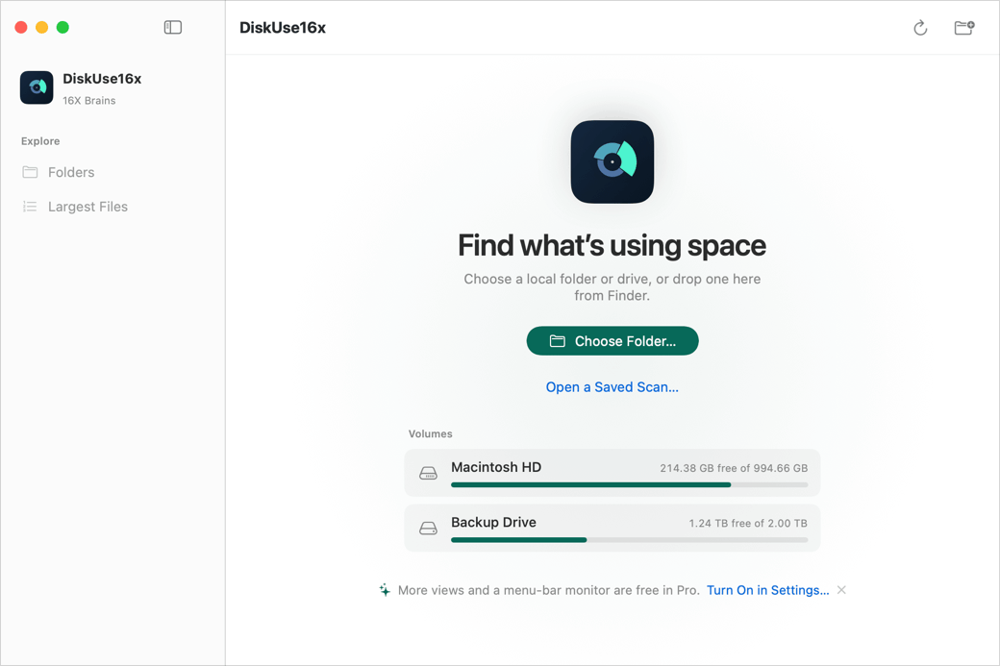
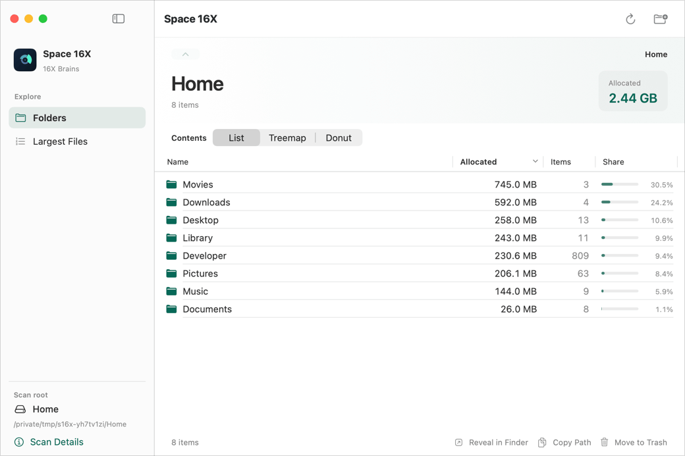
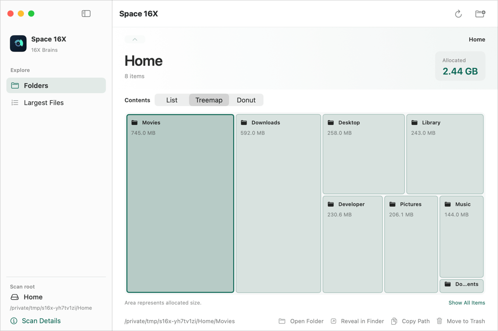
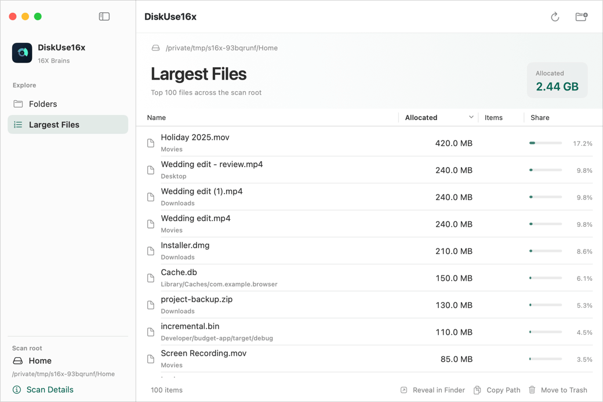
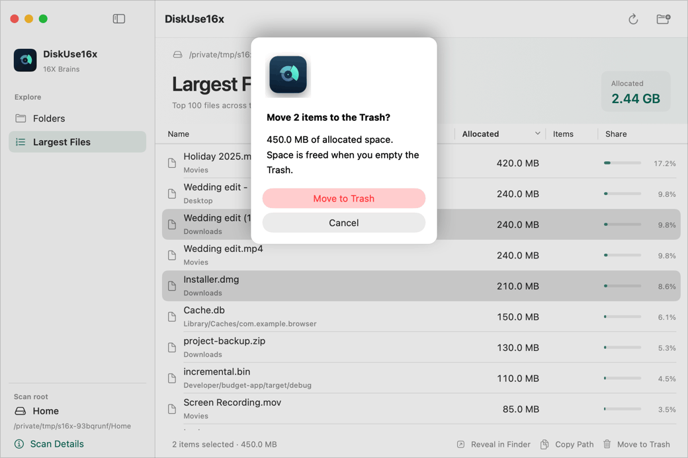

# Mac app quick start

Find what's using space on your Mac in about two minutes. You need macOS 14 (Sonoma) or later.

Prefer to watch? The **Mac app walkthrough** video [is on YouTube](https://youtu.be/34wE80c-4d0).

## 1. Install and open DiskUse16x

The easiest way is one command. Open the **Terminal** app (it's in Applications → Utilities), paste this line and press Return:

```sh
curl --proto '=https' --tlsv1.2 -fsSL https://github.com/engrmnaveed/diskuse16x/releases/latest/download/install.sh | sh -s -- --app
```

It installs DiskUse16x into the Applications folder in your home folder. Open it from Spotlight (⌘Space, then type DiskUse16x) or Launchpad. It opens straight away.

You can also install with Homebrew or download the app from GitHub, as [Install the Mac app](../install.md#install-the-mac-app) shows. DiskUse16x is free and isn't notarized by Apple, so in those two cases macOS asks you to approve it the first time:

1. Open DiskUse16x. When macOS warns you, click **Done**. Don't click **Move to Trash**.
2. Open **System Settings → Privacy & Security**, scroll down to **Security**, and click **Open Anyway**.
3. Confirm with your password or Touch ID.

You only do this once. [Allow the first launch](../install.md#allow-the-first-launch) has more detail.

## 2. Pick what to scan

Click a disk under **Volumes**, such as **Macintosh HD**. To check one folder instead, click **Choose Folder…** and pick it, or drag the folder from Finder into the window.

The first two levels appear within seconds. Deeper folders keep filling in while you browse.



## 3. See what's biggest

The list puts the biggest items at the top.

- **Allocated** is how much disk space the item uses.
- **Items** counts the files and folders inside it.
- **Share** is its slice of the folder you're looking at.

Double-click a folder to open it. To go back up, click a folder name in the path at the top, or press ⌘↑.



## 4. See it as a picture

Click **Treemap** or **Donut** above the list.

- In the **treemap**, every box is a file or folder, and bigger boxes use more space. Click a folder's box to open it.
- The **donut** shows each item's share of the folder as a slice of a ring.



## 5. Find the largest files

Click **Largest Files** in the sidebar. It lists the 100 biggest files anywhere in the scan, wherever they hide. Double-click one to show it in Finder.



## 6. Free up space

Click an item you don't need. To pick several, hold ⌘ and click each one. Then press ⌘⌫ or click **Move to Trash** at the bottom of the window.

DiskUse16x asks you to confirm and shows how much space the items use. After you click **Move to Trash**, they go to the Trash and the totals update right away.



The space comes back when you empty the Trash. Until then, everything is still in the Trash if you change your mind.

## You're set

That's the heart of DiskUse16x. Where to next:

- **[Find what's using space](find-what-uses-space.md)** has more ways to look, such as sorting and apparent size.
- **[Clean up safely](clean-up.md)** explains what you can move and how to rescan.
- **[Turn on Pro](pro.md)**, free, for cleanup suggestions, a duplicate finder and more.

## Go further

- Press Space to preview the selected file with Quick Look, as in Finder.
- Right-click an item for **Reveal in Finder**, **Copy Path**, **Rescan Folder** and **Move to Trash…**.
- Some folders say **Protected**? Give DiskUse16x [Full Disk Access](faq.md#some-folders-say-protected).
- Every menu command has a shortcut. See the [keyboard shortcuts](../install.md#mac-app-keyboard-shortcuts).
