# Space 16X Pro

Pro adds deeper views to Space 16X. It's free, like Basic, with nothing to buy or sign up for. Turn it on when you want more, and turn it off anytime.

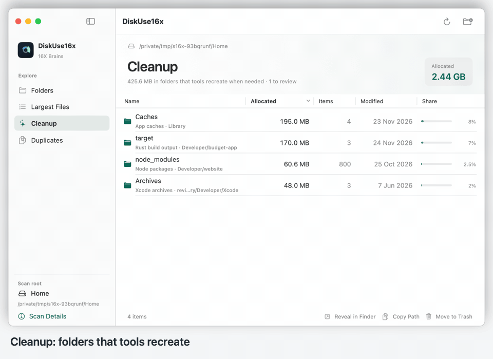

## Turn on Pro

- **Mac app:** open **Space 16X → Settings…** and switch on **Turn on Pro features**. It's the same app, so there's nothing to install. The new views appear right away.
- **Terminal:** run the installer again with `--pro` added, as [Install Space 16X Pro](../install.md#install-diskuse16x-pro) shows. Pro replaces Basic under the same `space16x` command, and `space16x --version` ends with `(pro)`. To switch back, run the installer without `--pro`.

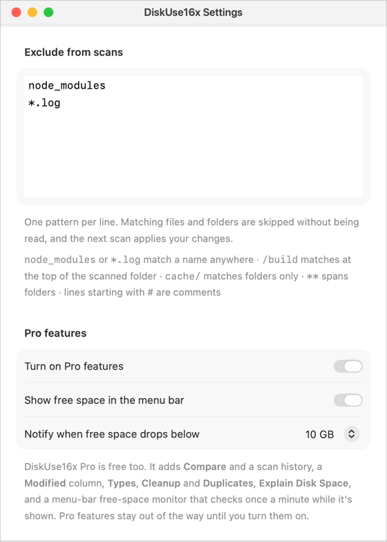

## What Pro adds

| Feature | What it answers | Mac app | Terminal |
| --- | --- | --- | --- |
| [Cleanup suggestions](#cleanup-suggestions) | What can I safely clear? | **Cleanup** in the sidebar | `u`, or `scan --cleanup` |
| [Duplicates](#duplicates) | Which files did I save twice? | **Duplicates** in the sidebar | `D`, or `space16x duplicates` |
| [Exclusive size](#exclusive-size) | What would removing this really free? | **View → Show Exclusive Size** | `X`, or `scan --exclusive` |
| [Older files](#older-files) | What haven't I touched in a year? | **View → Show Files Older Than** | `scan --older-than 365` |
| [File types and owners](#file-types-and-owners) | Is it videos? Photos? Whose files? | **Types** above the list | `t`, `scan --types 10`, `scan --by-owner` |
| [Compare and history](#compare-scans-and-keep-a-history) | What grew since last week? | **Compare…** above the list | `space16x diff`, `space16x history` |
| [Build Footprint receipts](#build-footprint-receipts-and-budgets) | How much did that install or build add? | **Scan → Save Footprint Receipt…** | `diff --budget` |
| [Explain Disk Space](#explain-disk-space) | Why doesn't the scan match my free space? | **Scan → Explain Disk Space** | `E`, or `space16x explain` |
| [HTML reports](#html-reports) | How do I share this with someone? | **File → Export HTML Report…** | `scan --html report.html` |
| [Menu-bar monitor](#menu-bar-free-space-monitor) | Am I running low? | **Settings → Pro features** | |
| [Several windows](#several-windows) | Can I look at two disks at once? | **File → New Window** | |
| [Terminal treemap](#terminal-treemap) | Can I see the terminal as a picture? | | `m` |

The terminal's explorer also adds a **Modified** column with each item's latest change, when the window is at least 96 characters wide. The app's lists add one too.

## Cleanup suggestions

Lists folders that apps and developer tools recreate on their own when they need them, biggest first: app caches, Xcode build data and device support files, simulator caches, `node_modules` folders, Rust build output, and the Gradle, npm and `.cache` folders. Clearing them is safe, though the tool may take longer the next time it rebuilds them. Quit apps before you clear their caches.

- **Mac app:** click **Cleanup** in the sidebar (⌘6). Select folders and move them to the Trash as usual.
- **Terminal:** press `u` in the explorer, mark folders with Space, and press `d`. Or run `space16x scan --cleanup` for a report.

Xcode archives and simulator devices are listed separately, under **review**, because they can't be recreated. Space 16X never selects anything for you, and it warns you plainly before moving one of those.

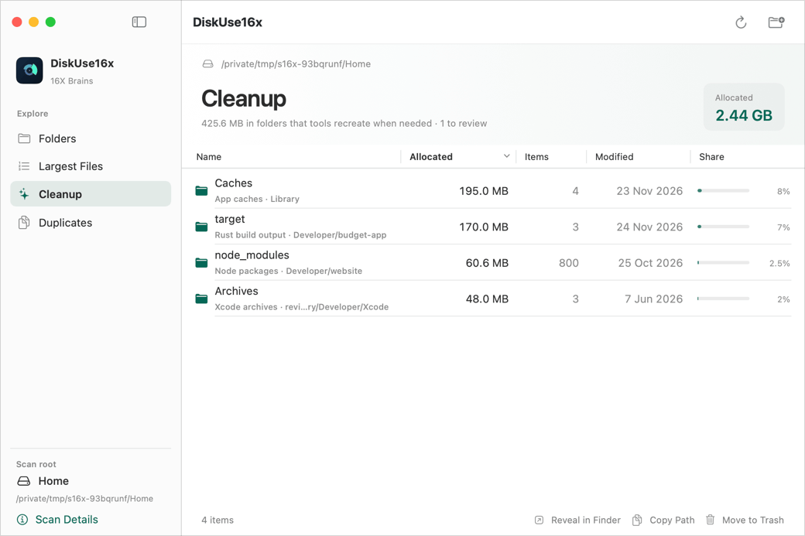

## Duplicates

Finds files with the same contents, grouped, with the space the extra copies use. It compares files of 1 MB or more.

- **Mac app:** click **Duplicates** in the sidebar (⌘7), then **Find Duplicates**.
- **Terminal:** press `D` in the explorer, then Enter to start. Or run `space16x duplicates`.

This is the only feature that reads what's inside files, and only after you start it. Some copies are marked **Clone, frees nothing** (`(clone)` in the terminal): on a Mac, a copy made in Finder can share its space with the original, so removing it frees nothing. The total counts only the space you can really get back.

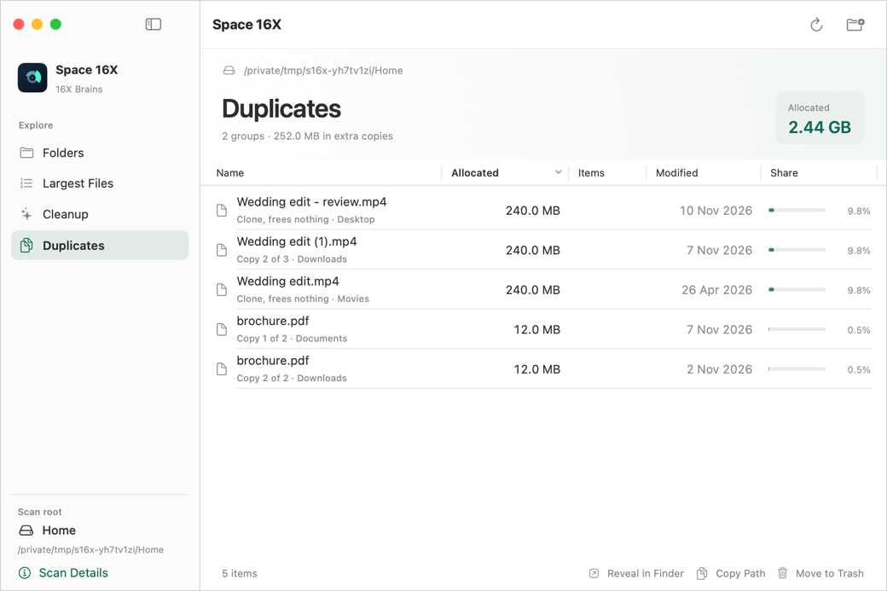

## Exclusive size

Adds an **Exclusive** column: the space that moving each item to the Trash and emptying it frees at least. It leaves out space shared with clones and with files that have other hard links, which removing the item wouldn't free.

- **Mac app:** choose **View → Show Exclusive Size**.
- **Terminal:** press `X` in the explorer, or add `--exclusive` to `space16x scan`.

Space 16X measures it after the scan, in the background, and shows its progress.

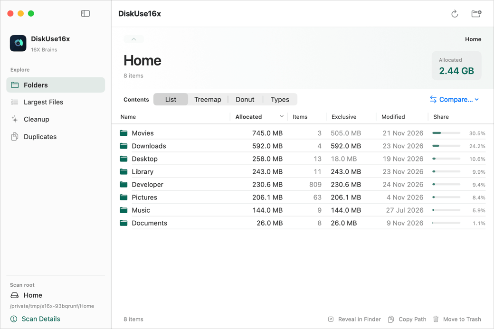

## Older files

Counts only files you haven't changed in a while, and the folders that hold them, so stale data stands out.

- **Mac app:** choose **View → Show Files Older Than**, then 30 or 90 days, 6 months, or 1 or 2 years.
- **Terminal:** run `space16x scan ~ --older-than 365` for files older than a year.

## File types and owners

See which kinds of files use the most space, such as `.mov` videos or `.jpg` photos.

- **Mac app:** click **Types** above the list (⌘5).
- **Terminal:** press `t` in the explorer, or run `space16x scan --types 10`.

On a shared Linux server, `space16x scan --by-owner` shows how much space each user's files take.

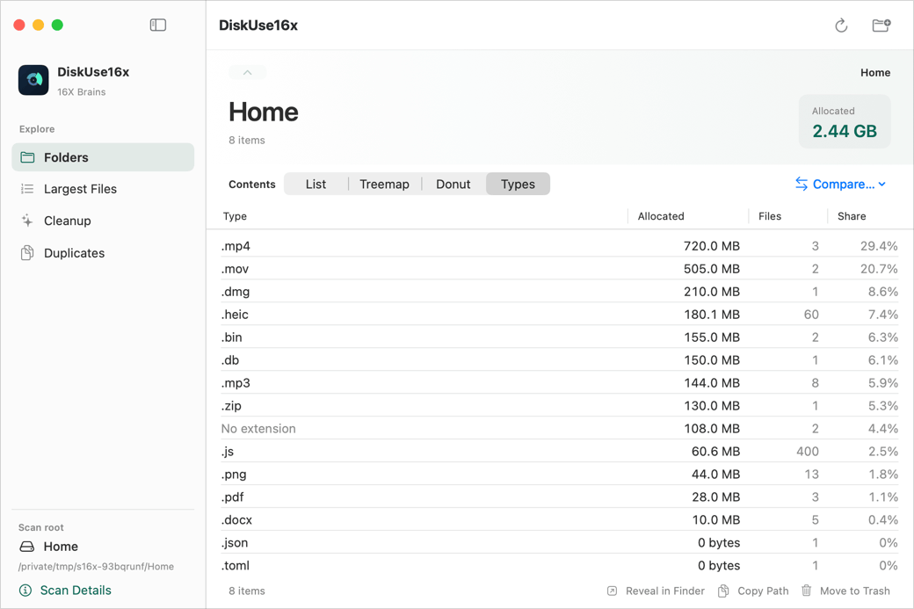

## Compare scans and keep a history

See what grew or shrank since an earlier scan.

- **Mac app:** click **Compare…** above the list. **Save to History** keeps the current scan. Next time, pick it from the same menu, or choose **Choose a Saved Scan…** for an exported one. A **Change** column shows what grew and what's new.
- **Terminal:** `space16x history save ~` keeps a scan of your home folder. Later, `space16x history diff ~` shows what changed since then. `space16x diff old.json ~` compares with any saved scan.

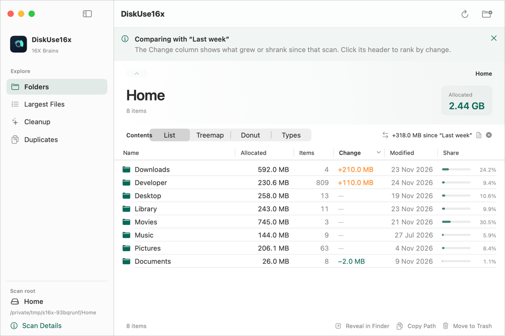

Only these saves write anything, and Space 16X never deletes the scans it keeps. The app keeps them in `~/Library/Application Support/Space 16X/History`, and **Scan → Show History in Finder** opens that folder. The terminal keeps them in `~/.local/state/space16x/history`.

## Build Footprint receipts and budgets

Measure how much space an install, an update or a build adds. Save a scan to the history, do the thing, then compare.

- **Mac app:** while comparing, choose **Scan → Save Footprint Receipt…**, or click the receipt button beside the comparison. Name what you measured, such as "first Xcode build", and optionally set a budget, such as 500 MB. The receipt is a short Markdown file with both totals and the files that changed most, and it says whether you stayed within the budget.
- **Terminal:** add `--budget 500M` to `space16x diff` or `space16x history diff`. Space 16X says whether the growth stayed within the budget and exits with code 3 when it didn't, so an automated build can stop on it.

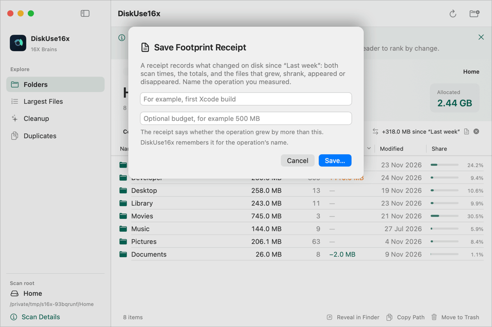

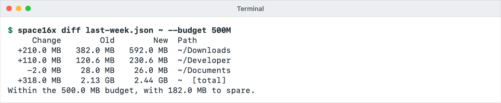

## Explain Disk Space

A scan counts the files in a folder. Your disk also holds space that no folder shows, which is why a scan rarely matches the free space Finder reports. Explain Disk Space shows it.

On a Mac, it lists the other volumes that share the disk, such as the system and VM (swap) volumes, **purgeable** space that macOS frees when it needs room, and Time Machine **local snapshots** with their dates. On Linux, it shows space reserved for the system administrator and deleted files that programs still hold open.

- **Mac app:** choose **Scan → Explain Disk Space** (⇧⌘X), or right-click a volume on the start screen.
- **Terminal:** press `E` in the explorer, or run `space16x explain`.

It only reads system figures, and it never deletes snapshots.

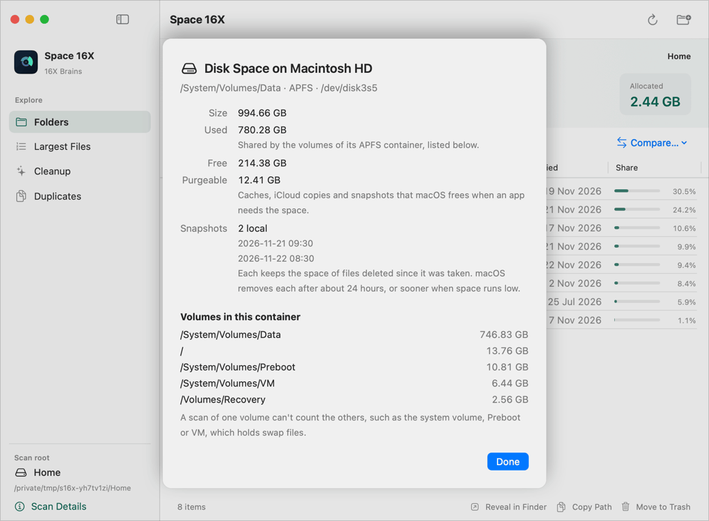

## HTML reports

Save a scan as a single web page that anyone can open in a browser: the totals, a treemap, the biggest items, the largest files and the file types. The page has no scripts and loads nothing from the internet.

- **Mac app:** choose **File → Export HTML Report…**.
- **Terminal:** run `space16x scan ~ --html report.html`.

The page shows full paths, so look it over before you share it.

## Menu-bar free-space monitor

Shows your startup disk's free space in the menu bar, with every volume's free space in its menu. It sends one notification when free space drops below the level you pick: 5, 10, 20, 50 or 100 GB, or never. It checks once a minute while it's shown and does nothing when it's off.

Turn it on in **Space 16X → Settings… → Pro features → Show free space in the menu bar**.

## Several windows

Choose **File → New Window** (⌘N) to open another window with its own scan, so you can browse two folders or disks side by side.

## Terminal treemap

Press `m` in the explorer to draw the open folder as boxes sized by the space they use. The arrow keys move the highlight, Enter opens a folder, and Space and `d` work as in the list. Press `m` again for the list.

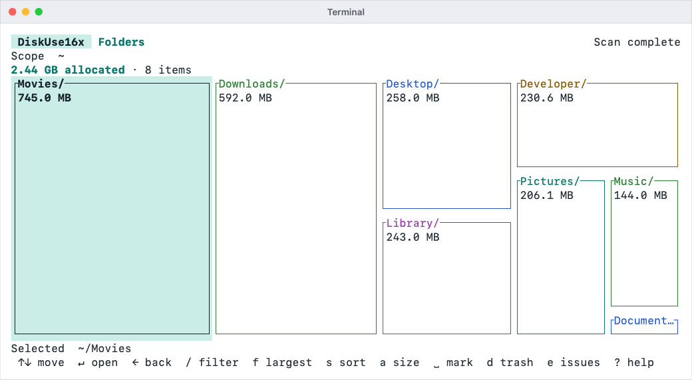

## Go further

The [Pro CLI reference](../cli-pro.md) documents every Pro command and option.
