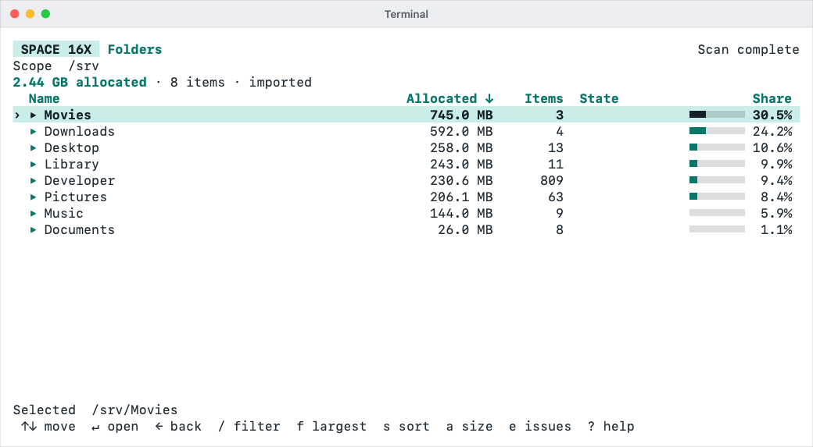
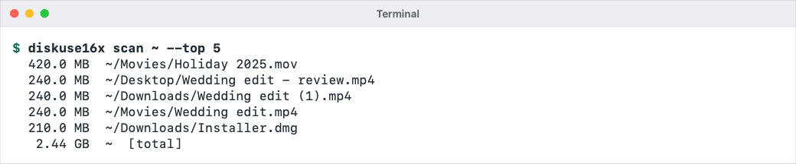

# Save, share and check servers

Keep a scan to look at later, open it on another computer, or check a server's disk from your own desk.

## Save a scan

- **Mac app:** choose **File → Export Scan…** (⇧⌘E) and pick where to save it.
- **Terminal:** add `--export` and a file name to a scan:

  ```sh
  diskuse16x scan ~ --export home.json
  ```

A saved scan is a single `.json` file with the name and size of every item. It doesn't include the files themselves.

## Open a saved scan

- **Mac app:** choose **File → Open Scan…** (⇧⌘O), click **Open a Saved Scan…** on the start screen, or drop the `.json` file into the window.
- **Terminal:** run `diskuse16x --import home.json`.

You can browse a saved scan like a fresh one. It's read-only: Move to Trash, Rescan and Reveal in Finder are off, because the files may be on another computer or may have changed since. The sidebar says **Saved scan, read-only** in the app, and the explorer's heading says **imported**.

DiskUse16x also opens scans saved by two other disk tools, ncdu and gdu, and they open DiskUse16x's.

## Check a server from your computer

`ssh` is the standard way to run a command on another computer, such as a server, from your own terminal. With `diskuse16x` installed on both computers, one line scans the server and opens the result in the explorer on yours:

```sh
ssh -C server diskuse16x scan / --export - | diskuse16x --import -
```

Replace `server` with the name you use for `ssh`, and `/` with the folder to scan. The scan runs on the server, and only the list of names and sizes travels to your computer. You browse it read-only, as with any saved scan.



To check a server later, save the scan to a file instead:

```sh
ssh -C server diskuse16x scan /srv --export - > srv.json
diskuse16x --import srv.json
```

## See which disk is filling up

Before you scan, find the disk that needs it.

- **Mac app:** the start screen lists your volumes with their free space. Click one to scan it.
- **Terminal:** run `diskuse16x volumes`:

  ```text
        Size       Used       Free  Use%  Inodes  Type    Mounted on
    98.30 GB   71.20 GB   22.00 GB   77%     12%  ext4    /
     2.00 TB    1.21 TB  690.15 GB   64%      1%  xfs     /srv
  ```

  **Inodes** is the share of file slots in use. A disk that runs out of them can't create new files, even with free space left. Sort the explorer by item count with `s` to find the folders that use them.

## Get a text report

`diskuse16x scan` prints a plain report you can paste into a message, save, or use in a script.

```sh
diskuse16x scan ~/Downloads             # the folder's contents, biggest first
diskuse16x scan ~ --top 10              # the 10 largest files
diskuse16x scan /Volumes/Work --depth 2 # two levels deep
diskuse16x scan ~ --json > report.json  # for scripts
```



The [CLI reference](../cli.md#generate-a-report) lists every option.

## Before you share

Saved scans and reports list the full path of every item, which can include names of people, clients or projects. Look through them before you send them to anyone.

## Go further

- On a hard disk or a network drive, add `--threads 1` to scan more gently. See [Threads](../cli.md#threads).
- ✨ **Pro, free:** compare two scans to see what grew, keep a scan history, and share a scan as a web page. See [DiskUse16x Pro](pro.md#compare-scans-and-keep-a-history).
