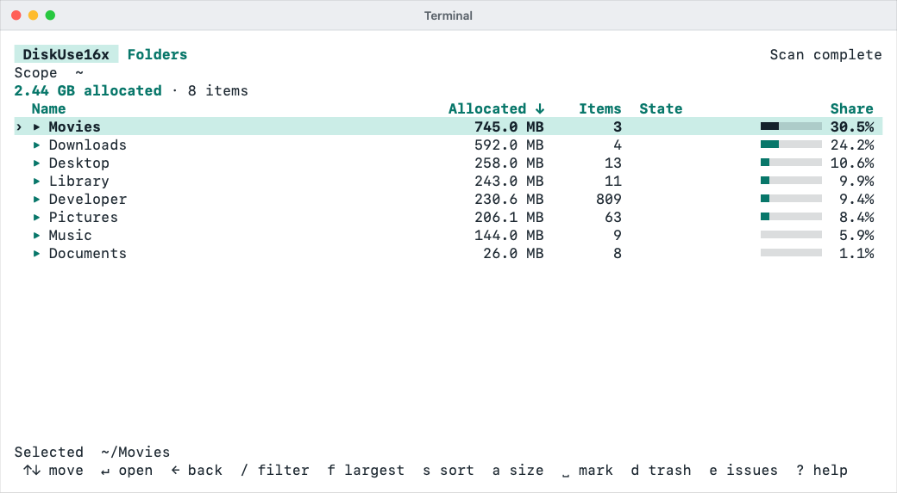
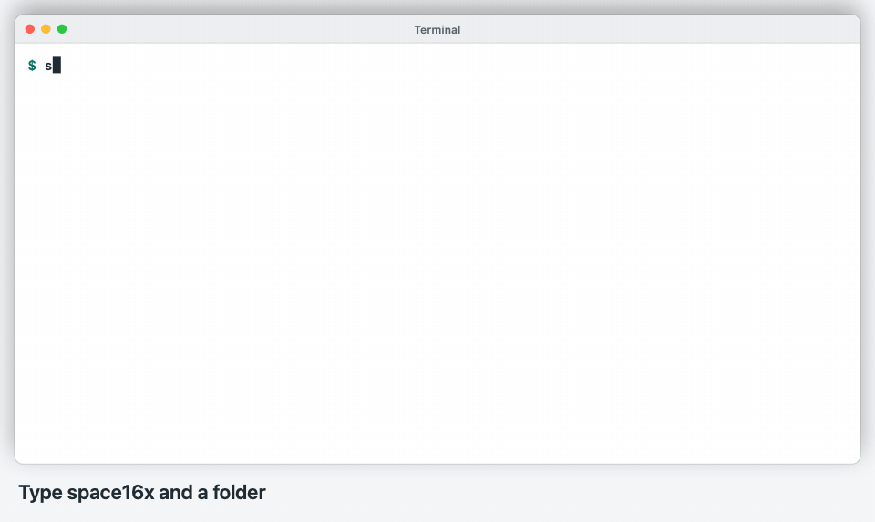
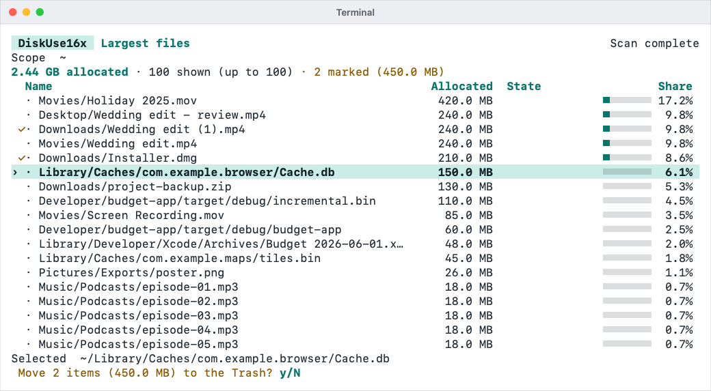

# Terminal quick start

Explore your disk from the keyboard, on a Mac or on Linux, in about two minutes.

The **terminal** is the window where you type commands: the Terminal app on a Mac, or the shell on a Linux computer or server. You type a command and press Return.

Prefer to watch? The **terminal walkthrough** video [is on YouTube](https://youtu.be/5aBSDL4HIuo).

## 1. Install

Copy the one-line installer from [Install the CLI](../install.md#install-the-cli-from-a-release), paste it into your terminal, and press Return. It installs the `diskuse16x` command for your user only, so it doesn't ask for an admin password. It also installs `du16x`, a shorter name for the same command, so you can type either one.

Already use Homebrew? Run `brew install engrmnaveed/tap/du16x` after the two setup lines in [Install the CLI with Homebrew](../install.md#install-the-cli-with-homebrew). On Debian, Ubuntu or Fedora, you can also [install a package](../install.md#install-a-linux-package).

Check that it worked:

```sh
diskuse16x --version
```

## 2. Open the explorer

Type `diskuse16x` and the folder to check, then press Return. `~` means your home folder:

```sh
diskuse16x ~
```

DiskUse16x scans the folder and opens the explorer. The biggest items are at the top, and the bar on the right shows each item's share. Running `diskuse16x` alone explores the folder you're in.



## 3. Move around

| Press | To |
| --- | --- |
| ↑ and ↓ | Move the highlight |
| Enter | Open a folder, or see a file's details |
| ← or Backspace | Go back up |
| `f` | List the largest files in the whole scan, and press `f` again to go back |
| `?` | See every key |
| `q` | Quit |



## 4. Free up space

1. Highlight an item you don't need and press Space to mark it. A ✓ appears beside it. Mark as many as you like.
2. Press `d`. The bottom line asks, for example, "Move 2 items (50.3 MB) to the Trash? y/N".
3. Press `y` to move them. Any other key keeps them.



The totals update right away. The space comes back when you empty the Trash. On Linux, items go to the same Trash your file manager uses, so you can restore them from there.

## You're set

That's the heart of DiskUse16x. Where to next:

- **[Find what's using space](find-what-uses-space.md)** has more ways to look, such as sorting and filtering.
- **[Save, share and check servers](save-and-share.md)** shows how to scan a server and browse the result on your own computer.
- **[DiskUse16x Pro](pro.md)**, free, adds cleanup suggestions, a duplicate finder and more.

## Go further

- Press `/` and type part of a name to show only matching items. Esc clears the filter.
- Press `s` to sort by size, item count or name.
- Press `r` to rescan the open folder after you change files elsewhere.
- Type `diskuse16x scan` for a plain text report you can save or paste, or `diskuse16x scan --top 10` for the 10 largest files.
- On a shared server, `diskuse16x --read-only` turns off Move to Trash.
- The [CLI reference](../cli.md) lists every key and option.
